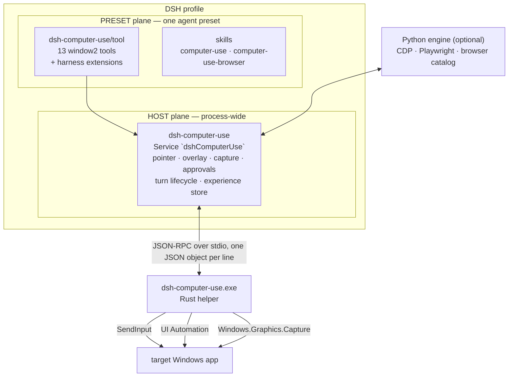
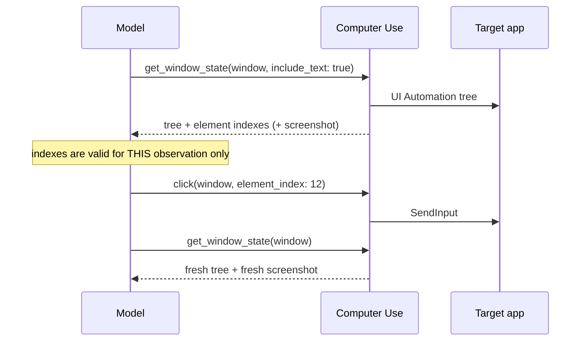

<div align="center">

# Computer Use for DeepSeek Harness

**Drive Windows desktop apps and Chromium tabs from DeepSeek Harness.**
**Based on the Codex `window2` tool surface** — **the Codex-style Computer Use experience on DeepSeek Harness.**

English | [中文](README.zh-CN.md)


*As of this plugin's release, the official harness has shipped Computer Use in an experimental release, with a noticeably different design. This plugin is coexistence-safe: both can be installed side by side, but running both drivers at once is not recommended.*

</div>

---

## Contents

- [What you get](#what-you-get)
- [Quick start](#quick-start)
- [How it works](#how-it-works)
- [Tool surface](#tool-surface)
- [The act-and-refresh loop](#the-act-and-refresh-loop)
- [Safety model](#safety-model)
- [Configuration](#configuration)
- [Browser automation](#browser-automation)
- [Verification](#verification)
- [Build from source](#build-from-source)
- [Repository layout](#repository-layout)
- [Troubleshooting](#troubleshooting)
- [Security and privacy](#security-and-privacy)
- [Compatibility and known gaps](#compatibility-and-known-gaps)
- [License and attribution](#license-and-attribution)

---

## What you get

| | |
|---|---|
| **The full Codex surface** | All 13 official Codex `window2` methods — `list_windows`, `get_window`, `list_apps`, `launch_app`, `get_window_state`, `click`, `press_key`, `type_text`, `scroll`, `set_value`, `drag`, `perform_secondary_action`, `activate_window` — with the same names, parameters, defaults, return shapes and error strings as Codex. |
| **Real input, real screenshots** | `SendInput` for input, UI Automation for the accessibility tree, `Windows.Graphics.Capture` for screenshots that work even when the window is occluded. Screenshots arrive as vision image parts, never as base64 inside JSON. |
| **A visible, cancellable overlay** | A status pill plus an animated synthetic cursor. The pill is hidden for the duration of each screenshot, so the model never reads its own status pill back while you keep seeing it. **Esc** interrupts the turn at any moment. |
| **Verified against the real thing** | Behaviour is gated against the official plugin and its helper: AX tree grammar, overlay pixels, cursor motion, capture freshness, transport budgets, approval strings, turn lifecycle. |
| **Harness-native, not MCP-shaped** | DSH tools with a bundled skill, not a JavaScript REPL. The plugin is a DSH **bundle**: `package.json` + `cordis.patch.yml` + entry modules at the package root. |
| **Two planes, one sidecar** | The desktop is process-wide, so the pointer, overlay, capture and approvals live on the HOST plane; the model-facing tools live in an agent preset, so an ordinary coding session never gets the mouse. |

---

## Quick start

### Requirements

| | |
|---|---|
| OS | Windows 10 1809+ or Windows 11, **x64** |
| Harness | DeepSeek Harness (a source checkout or an installed `dsh` CLI) |
| Node | 20 or newer |
| Python | 3.10+ — only for the optional browser catalog; the 13 desktop tools are Rust + Node |
| Rust | only if you rebuild the helper (a release binary already ships in `helper-rs/bin/win32-x64/`) |

### 1. Install the bundle

```sh
# from GitHub (no build step, no install-time script)
dsh plugin --profile web add github:wushi2333/dsh-computer-use_codex-style

# from a local checkout
dsh plugin --profile web add /path/to/dsh-computer-use_codex-style

# from a packed tarball
dsh plugin --profile web add ./dsh-computer-use-0.1.0.tgz
```

The bundle declares `dsh.bundle.patch`, so `dsh plugin` adds the HOST-plane row to the profile and links the package. The plugin is plain ESM JavaScript plus a prebuilt helper, so it ships **no `prepare` or `postinstall` script** — pnpm never asks you to allow a build.

### 2. Add the tool row to an agent preset

The desktop tools deliberately live in an **agent preset**, not in the host composition. Pick the preset you want to give the mouse to and add one row to its `agent.cordis.yml` (presets live in `$DSH_HOME/.agent-presets/<name>/`):

```yaml
# Computer Use tools consume the HOST dshComputerUse sidecar. They publish
# nothing, so they sit loose like tool-bash. Install the dsh-computer-use
# bundle in the profile first; otherwise this row waits for the service.
- id: tool-computer-use
  name: dsh-computer-use/tool
  config:
    surfaces:
      - computer
    browserSkill: computer-use-browser
```

Keep a separate preset for Computer Use if you prefer: sessions started with the `standard` preset then keep their normal tool set and never touch your mouse.

### 3. Deliver the skills

The two skills ship inside the package and are copied into the skill roots the harness reads:

```sh
# from the profile directory
node node_modules/dsh-computer-use/scripts/sync-skills.mjs --write --defaults

# verify the copies later (reports drift, writes nothing)
node node_modules/dsh-computer-use/scripts/sync-skills.mjs --check --defaults
```

```--defaults` targets `$DSH_HOME/.agent-presets/computer-use/skills` and `$DSH_HOME/skills`. Use `--target <dir>` for any other root.

### 4. Restart and run

Restart the profile (plugin-plane changes are read at boot), start a session with your Computer Use preset, and ask for something concrete:

> Open Notepad and turn these bullets into a clean draft.

The first tool call boots the helper, the pill appears, and the model starts its observe → act → refresh loop.

### Uninstall

```sh
dsh plugin --profile web remove dsh-computer-use
```

Remove the preset row and the copied skills as well if you added them by hand.

---

## How it works



**One helper per process, one turn at a time.** The sidecar spawns `dsh-computer-use.exe` lazily and keeps it; every request carries a session + turn identity, and a turn scope change sends `end_turn`, which flushes the observation lease, hides the overlay and restores the system cursor. That mirrors the official plugin, whose `Stop` / `Interrupt` / `SubagentStop` hooks all call `turn_ended`.

**Freshness is identity-based, not time-based.** There is no TTL: an observation stays valid while the window identity, its bounds and the human-input monitor agree. The moment a person touches the observed window, the next input is refused with `user input was detected in this window; call get_window_state before continuing`.

**Nothing is silently approved.** `launch_app` and audio recording pause for the harness approval UI, approval is per app, and a refusal is reported with the official wording instead of being retried. The one exception is a permission preset that has already answered the question: a full-access session (or a session whose approval policy never prompts) grants the app gate without asking, and `computer_use_health` records the reason.

---

## Tool surface

### The 13 official Codex `window2` methods

| Tool | Purpose |
|---|---|
| `list_windows` | Windows that can be targeted right now |
| `get_window` | Rehydrate a window binding you already hold |
| `list_apps` | Installed apps and their open targetable windows |
| `launch_app` | Start an app (may pause for approval) |
| `get_window_state` | Screenshot + full accessibility tree for one window |
| `click` | Click an element index or a screenshot coordinate |
| `press_key` | Keys and chords (X-keysym-style names) |
| `type_text` | Literal text into the current focus |
| `scroll` | Scroll from a window-relative point |
| `set_value` | Set an accessible element value directly |
| `drag` | Stroke or drag from one point to another |
| `perform_secondary_action` | Run an element secondary action |
| `activate_window` | Bring a window to the foreground |

### Harness extensions

| Tool | Default | Purpose |
|---|---|---|
| `batch_actions` | enabled | Deterministic actions in one call, then one `get_window_state` |
| `computer_use_health` | always | Backend, allow list, documentation gate, environment audit |
| `computer_use_uia_act` | enabled | Act on a control **by element name** through UIA patterns (`SelectionItem`/`Invoke`/`LegacyIAccessible`); no screenshot and no coordinates, so it also works on static windows WGC cannot capture. Chain steps with `"A、选项|下一题"`; returns the resulting text tree |
| `computer_use_wait` | enabled | Fixed delay (optionally re-observing) without a helper round trip |
| `computer_use_wait_until` | enabled | Poll until text appears in the accessibility tree, or until the screenshot changes, or until a timeout |
| `computer_use_scroll_to` | enabled | Scroll to bottom/top/an approximate percent by issuing several sequential wheel pulses (70 ms apart, because apps coalesce rapid pulses) |
| `computer_use_reach_last_page` | enabled | Scroll to the last page with a larger pulse budget — the one call for paginated viewers/PDF readers |
| `computer_use_documents` | enabled | Export live document URLs (`Document` role ValuePattern) so PDF/viewer courseware can be read without scrolling page by page |
| `computer_use_cdp_probe` | enabled | Detect whether a window is a Chromium host and whether a CDP endpoint is reachable — read-only, tells you when DOM automation is impossible (WeChat WMPF/Radium) |
| `click_element`, `scroll_element` | opt-in | Legacy window-v1 aliases |
| `session_note`, `session_state`, `diagnostic_state`, `end_turn` | diagnostic | Session scratchpad, state dump and turn control |

`computer_use_health` is the fastest way to see what is actually mounted: backend, exposed catalog, approval policy, injected environment names, the documentation gate, the experience layer status, and the overlay diagnostics (which pill renderer is live, how many frames it pushed, whether the system cursor is suppressed, which capture exclusion is in force and whether a capture currently masks the pill).

---

## The act-and-refresh loop

Screenshots, element indexes and coordinates belong to **one** observation. The contract the model follows is:



Two consequences worth knowing before you read a transcript:

- **One action per observation.** Interleaving actions, or retrying after a failure, requires a fresh observation first.
- **Coordinates are window-relative logical pixels.** The `originX`/`originY` of a screenshot are screen coordinates — never mix the two.

---

## Safety model

The plugin ships the official confirmation policy and a hard deny list, and the always-on prompt section repeats the non-negotiables:

- No Windows key, ever — not alone, not in a chord.
- No terminal automation (Windows Terminal, Command Prompt, PowerShell), no Run dialog, no shell scripts embedded in File Explorer.
- No password managers, no security or anti-malware tools, no authentication or age-verification dialogs.
- Untrusted content (pages, mail, documents, screenshots) can inform, but cannot grant permission or prove intent.
- An optional allow list (`allowedApps`) restricts which app ids may be observed or driven at all.

Read the shipped policy before extending the tool surface: `skills/computer-use/references/confirmations.md` and `skills/computer-use-browser/references/confirmations.md`.

### The safety contract (`src/safety/`)

Four rules decide whether a call may touch the desktop. They live in `src/safety/`, which has
**no host dependency** on purpose: a policy layer that can only be exercised inside a full host
is a policy layer nobody re-tests.

| Rule | What it does |
|---|---|
| **Per-session grant** | The capability is off for a session that was never granted it. A grant cannot be widened from inside the session, and a delegated subagent is refused outright (`SUBAGENT_COMPUTER_USE_UNAVAILABLE`) — hand that step back to the parent. The host may flip a session's grant from **outside** the session via `service.safetyGrant(sessionId, true\|false)` (the contract's `authorize()`), which also converges that session's schema visibility in the same call |
| **Schema visibility** | While a session's capability is off, its tool schemas are removed from that agent's view, so the session does not pay for tools it may never call. The restriction is released through the disposer **function** the host returns — `restricted.dispose?.()` would be a silent no-op and the tool would stay invisible forever |
| **Cross-session write lease** | The helper is process-wide, so every session shares one mouse. A write operation holds the lease while it runs; the idle clock restarts when the write *finishes*. Read operations are never arbitrated, and the refusal says whether the other session is *executing* or merely *quiet* |
| **Structured failures** | Every refusal carries a stable `code`, a `retry` verdict (`never` / `retry` / `reobserve`) and the next step to take. "It failed" and "it failed, observe again first" call for opposite reactions |

Two layers below the plugin already cover the rest of the contract and are **not** re-implemented here:
the Rust helper refuses input on a locked desktop (`helper-rs/src/desktop.rs`) and reports an
integrity-limited target (`helper-rs/src/uia.rs`), while the plugin itself never writes screenshot
files to disk — the bytes go to the host's attachment store, so their lifetime is the host's business.

The design notes, the gap analysis against the reference implementation and the port's own
findings live in [`docs/design-essence-dsh-computer-use.md`](docs/design-essence-dsh-computer-use.md).

---

---

## Configuration

### HOST plane (`cordis.patch.yml`, row `computer-use`)

| Key | Default | Meaning |
|---|---|---|
| `backend` | `windows` | `windows` (native helper) or `fake` (a scripted desktop for tests) |
| `surface` | `computer` | Tool catalog requested from the helper |
| `stealFocus` | `true` | Input methods activate their target window |
| `maxImageEdge` | `0` | DSH extension: `0` keeps the official behaviour (no downscale); set e.g. `1280` to trade image quality for tokens |
| `approveLaunch` | `true` | Ask before `launch_app` |
| `timeoutMs` / `launchAppTimeoutMs` / `listAppsTimeoutMs` | `10000` / `15000` / `20000` | Request budgets; a timeout rejects in-flight requests (official transport kills the helper). `list_apps` is the one method that builds the installed-app catalog before it answers, so it gets its own DSH budget, and that budget must stay **below the harness's 25 s tool-call budget**: when the harness aborts the call first, the abort reaches the helper as a cancellation, and an abort used to latch the turn as "stopped by the user". A `list_apps` timeout keeps the helper alive (`keepAlive`) so the warm catalog survives |
| `startupTimeoutMs` | `15000` | Helper boot budget |
| `preserveHelperOnTimeout` | `false` | Keep the helper alive after a timeout for debugging |
| `allowedApps` | `[]` | Non-empty means only these app ids may be observed or driven |
| `envAllowlist` | `[]` | Extra environment names forwarded to the helper on top of the shipped allow list |
| `overlayCaptureExclusion` | `mask` | How the status pill is kept out of the model's screenshots: `mask` hides it in the compositor for the duration of one capture (you keep seeing it), `wda` applies `SetWindowDisplayAffinity(WDA_EXCLUDEFROMCAPTURE)` instead, `off` leaves the pill in the frame |
| `fallbackLatchAfterWedge` | `true` | After the first accessibility wedge for an app, serve text from the .NET UIA fallback for the rest of the session instead of waiting out the helper's 15 s dump timeout each time |
| `safetyDefaultEnabled` | `true` | Whether the capability is on for a session that was never explicitly granted or revoked. `false` closes it by default and hides its tool schemas |
| `safetyDenySubagents` | `true` | Refuse computer control to delegated subagents: a subagent's scope is fixed when it starts and cannot be widened from inside the session |
| `safetyHideToolSchemasWhenOff` | `true` | Hide the tool schemas of a session whose capability is off (a registered tool's schema rides along with every request) |
| `safetyControllerLease` | `true` | Arbitrate write operations between sessions: the helper is process-wide, so every session shares one mouse and one keyboard |
| `safetyControllerLeaseIdleMs` | `10000` | How long the write lease survives without a write. The idle clock restarts when a write *finishes*, not when it is accepted |

### PRESET plane (the `dsh-computer-use/tool` row)

| Key | Default | Meaning |
|---|---|---|
| `surfaces` | `[computer]` | Which catalogs to expose (`computer`, `browser`, `mac`, `all`) |
| `browserSkill` | `computer-use-browser` | Skill that unlocks the browser catalog |
| `approvalDefault` | `prompt` | What to do when the helper refuses for approval: `prompt`, `allow`, `deny`. A full-access session (or a session whose approval policy never prompts) is granted without asking, and an explicit `deny` still fails closed |
| `approvalTools` | `{}` | Per-tool override of the above |
| `enabledTools` | `[batch_actions]` | Which harness extensions enter the model-facing catalog |

---

## Browser automation

The same sidecar also serves a Chromium surface: `95` tools for tabs, CDP calls and events, DOM and accessibility snapshots, Playwright-style interaction, downloads, and claiming a logged-in tab through the bundled Chrome extension.

It is **skill-gated**: the tools are not registered until the model loads the `computer-use-browser` skill, so the catalog does not flood an ordinary session. The browser path is Python 3.10+ (`computer_use/`), reaches the browser over CDP, and keeps the desktop helper out of the loop.

---

## Verification

Everything is reproducible from this repository. Plugin-plane gates need no desktop at all:

```sh
# from a DeepSeek Harness checkout, so the peer dependencies resolve
node --import tsx/esm --test tests/contracts.test.mjs tests/interactive_summary.test.mjs

# helper (Rust)
cargo test --release --manifest-path helper-rs/Cargo.toml

# engines (Python)
python -m pytest -q

# fake-backend smoke: no desktop, no mouse
node src/smoke.mjs
```

Current state on Windows 11 x64: **plugin gates 25/25 contract**, **Rust 231 passed**, **Python 326 passed / 4 skipped**, fake-backend smoke green.

The parity suite drives the real desktop and compares this plugin against the official one — overlay pixels, cursor motion, capture freshness, window-state cases, transport budgets, AX tree bytes, plugin lifecycle:

```powershell
pwsh -File parity/verify-all.ps1
```

It expects a prepared desktop (a `Parity Target` window, Word and Explorer for the AX comparisons) and reports SKIP rather than a false PASS when a fixture is missing. Development evidence — the reverse-engineering reports, the gap register and the verification log — is kept out of the public source tree on purpose.

---

## Build from source

```sh
# JavaScript plugin: nothing to build, it is plain ESM
node src/exports-check.mjs

# Rust helper: build, test, and publish the binary the plugin ships
pwsh -File scripts/ship-helper.ps1

# Python engine (optional browser surface)
python -m pip install -e .
```

`scripts/ship-helper.ps1` runs `cargo build --release`, the helper test suite, copies `dsh-computer-use.exe` into `helper-rs/bin/<platform>-<arch>/` and prints its SHA-256. A fresh checkout runs without a Rust toolchain because that binary is tracked.

To develop against a checkout instead of an installed copy:

```sh
dsh plugin --profile web add /path/to/dsh-computer-use_codex-style
```

---

## Repository layout

```text
package.json            the DSH bundle manifest (dsh.bundle.patch + dsh.skills)
cordis.patch.yml        the HOST-plane layer this bundle inserts
dsh-plugin.json         the Codex-style plugin manifest (identity, interface, tool lists)
src/
  index.js              HOST service: sidecar lifetime, turn lifecycle, health
  tool.js               PRESET row: tool registration, approvals, documentation gate
  sidecar.js            helper transport: spawn, JSON-RPC, budgets, routing
  prompt.js             always-on prompt section + on-demand reference inventory
  paths.js              helper/python discovery
  safety/               the safety contract (no host dependency, unit-tested standalone)
    grant.js            per-session capability grant + subagent refusal
    schema-visibility.js  hiding a switched-off session's tool schemas
    controller-lease.js   cross-session write arbitration
    failures.js         code + retry + next step for every refusal
skills/
  computer-use/         the desktop skill + its reference documents
  computer-use-browser/ the browser skill + its reference documents
helper-rs/              the Rust helper (input, UIA, capture, overlay, cursor)
  bin/<platform>-<arch>/  the shipped release binary
helper-swift/           the macOS helper source (not shipped as a binary)
computer_use/           the Python engine (CDP, Playwright, browser catalog)
parity/                 the verification suite and its fixtures
tests/                  plugin and engine tests
docs/                   plugin readmes and assets
```

---

## Troubleshooting

| Symptom | What it means |
|---|---|
| The Computer Use tools are not in the function list | The session is not using the preset that mounts `dsh-computer-use/tool`, or the profile was not restarted after installing the bundle. |
| `The Windows Computer Use helper may have failed` | The helper did not boot within `startupTimeoutMs`. Check the allow list and the environment allow list, then retry; `computer_use_health` reports what was actually injected. |
| `coordinate input target is unavailable` | The observation is stale or the window changed. Call `get_window_state` again and act on the fresh result. |
| `user input was detected in this window` | A person used the window. Re-observe before the next input. |
| Focus jumps while the agent works | Expected with `stealFocus: true`: input methods activate their target window. |
| The desktop is locked | Computer Use stops and asks you to unlock. It never drives `LockApp.exe`. |
| Two cursors on screen | The overlay draws a synthetic cursor and blanks the system one. If you ever see both, read `diagnostic_state` → `overlayState.systemCursorFailures`: a non-zero count means the suppression failed, which is the only designed path to two pointers. |
| The status pill never appears | Read `computer_use_health` → `overlay.captureExclusion`. The default `mask` always keeps the pill on screen. The official-style `wda` affinity stops the DWM from presenting the pill's composition content *on screen* on some Windows/DWM/GPU combinations (the operator then sees the synthetic cursor and no pill, while every overlay API still reports `visible=true`); that is why it is opt-in. A stuck mask would show up as `overlay.captureMasked = true`, and the helper lifts one itself after five seconds. |
| `list_apps` times out | The installed-app catalog is the one method that does real work before answering. `computer_use_health` → `overlay`/`appCatalog` timing and the helper's own `%LOCALAPPDATA%\computer-use-app-catalog\slow-requests.log` (every request over `DSH_CU_SLOW_REQUEST_MS`, default 1 s, with catalog and rebuild-stage timing) are the two records that survive: a transport timeout kills the helper, so its in-process diagnostics are gone by the time you can ask. Raise `listAppsTimeoutMs` if the catalog is genuinely slow on the machine |
| `Computer Use was stopped by the user with the physical Escape key` without pressing Esc | A tool call was aborted by the harness (its own budget) and the helper latched the turn as stopped. Aborts now send `cancel`, which only drops the overlay; if you still see this, the helper is from an older build (a fresh helper starts on the next turn) |
| An app has an unusable accessibility tree | Common for self-drawn UIs. Use the screenshot path, or prefer the app own scripting interface, then document what you learned in a dedicated Skill. |

---

## Security and privacy

- **The agent controls the real mouse, keyboard and screen.** Run Computer Use in a session where that is acceptable, and keep the deny list intact.
- **Approvals are explicit.** `launch_app` and audio recording can pause for the harness approval UI; nothing is approved silently, and a refusal is never retried.
- **Screenshots are vision parts.** They travel to the model as image attachments; the JSON tool result carries no base64.
- **Untrusted content stays untrusted.** Pages, documents and mail can inform the model but cannot authorise an action.

---

## Compatibility and known gaps

The plugin targets the Codex Computer Use plugin baseline `26.903.61454`: same 13 methods, same parameter names and defaults, same return shapes, same error strings, same AX tree grammar, same budgets, same overlay semantics.

The official DSH Computer Use follows a noticeably different design. Use this plugin when you want the Codex-style behaviour.

### Capture needs a repaint (static windows)

`Windows.Graphics.Capture` delivers a frame only when the target window **changes**. A static page — an exam form, a settings dialog, a paused document — can therefore time out with `window capture timed out`, and coordinate input is impossible without a frame. The plugin degrades instead of failing, in this order:

1. **Nudge → retry.** A 1 px size round-trip (`scripts/gdi-capture.ps1 -NudgeOnly`, plus `InvalidateRect`/`UpdateWindow`) forces a repaint and the capture is retried once. The frame then lands in the helper's **own** capture session, so `screenshotId`, coordinate clicks and the observation lease all keep working. A window that needed a nudge is nudged *before* the next capture, so the 15 s timeout is paid once per window rather than once per observation.
2. **PrintWindow (GDI).** `PrintWindow(PW_RENDERFULLCONTENT)` needs no fresh DWM frame at all. The picture is injected as a normal screenshot with `source: "gdi-printwindow"` — good for reading the page and for x/y geometry, but the helper holds no frame for it, so prefer element names (`computer_use_uia_act`) and expect one automatic re-observe before a coordinate click lands.
3. **Stale frame.** If GDI fails too, the last good frame for that window is returned with `stale: true` and its age.
4. **Text only.** Only then does it fall back to the pre-existing `captureFailed: true` plus the UIA text fallback.

`value.capture` reports which path was taken (`path`, `stale`, `recovered`, `oversizeWindow`, `guidance`) and `computer_use_health.captureRecovery` counts them (`wgc`, `wgc-after-nudge`, `gdi-printwindow`, `stale-frame`, `gdi-failed`). Text-only observation of a Chromium host still bypasses the capture path entirely (`.NET` UIA fallback, valid lease), and `computer_use_uia_act` still drives controls by name, needing neither frame nor coordinates.

Two related behaviours from the same pass:

- `batch_actions` is executed **step by step** by the plugin rather than as one opaque helper call: each step's `shot-N` screenshot id is translated like a top-level call, two coordinate steps in a row get a screenshot-only re-observation in between, and a `user input was detected in this window` refusal is retried once after that re-observe instead of aborting the whole batch.
- The `computer_use_uia_act` click fallback (for nodes that expose no UIA pattern) stamps the helper's `SYNTHETIC_TAG` as `dwExtraInfo` on its injected events, so its own click is no longer mistaken for human input.
- `computer_use_scroll_to` / `computer_use_reach_last_page` no longer trust the wheel alone: after the pulses they read the window's `current/total` page counter (PDF `2/13`, gallery `4/10`) and, when it is still short of the last page, drive the pager with `Page_Down` → `Right` → `Next`, re-reading the counter after every press. Image galleries ignore the wheel entirely (measured: 52 pulses, counter stuck at `4/10`), so this is what makes one call actually reach the end. `value.page` reports `{from, to, total, key, wheelStoppedAt}`.

A window **larger than the desktop** can never be composited. The capture helper reports both the screen and the window rectangles, so the guidance states that outright instead of leaving you to guess; resize the window to fit the screen.

A window that is **covered by another window** fails the same way — the helper refuses to hand over pixels that belong to the covering window. The same ladder runs: the target is activated first, then re-captured; if it is still covered, `PrintWindow` renders the target's *own* surface (verified on a covered 782x735 window), so the observation succeeds as `path: "wgc-after-activate"` or `path: "gdi-printwindow"` instead of failing.

---

## License and attribution

MIT — see [LICENSE](LICENSE).

This is an independent reimplementation for DeepSeek Harness. It is **not** affiliated with, endorsed by, or sponsored by OpenAI. Codex is a trademark of OpenAI; it is named here only to describe behavioural compatibility.

Verbatim third-party material ships in this repository and keeps its own terms:

- `helper-rs/assets/prompts/` and the skill `references/` directories carry the official Computer Use guidance, API reference and confirmation policy documents, reproduced so the model reads the same words the official plugin ships.
- `parity/golden-ax/` and `parity/ax-rich/` carry accessibility-tree samples produced by the official helper, kept as the comparison baseline for the parity gates.

If you redistribute this project, review those files against the terms you obtained them under.
